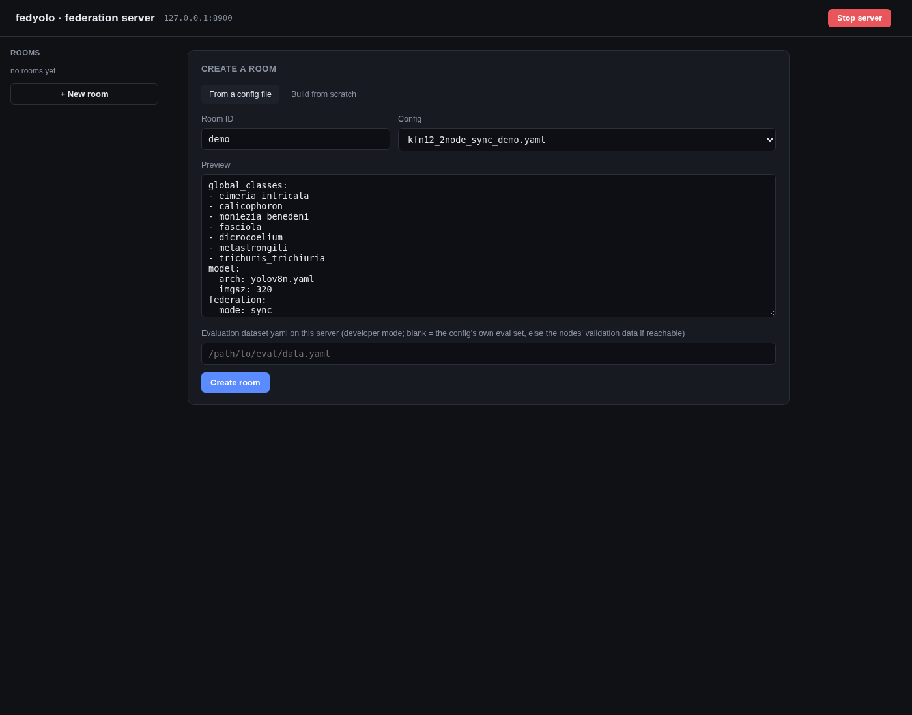
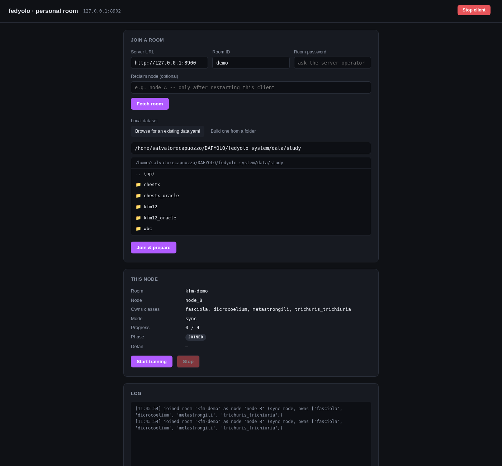
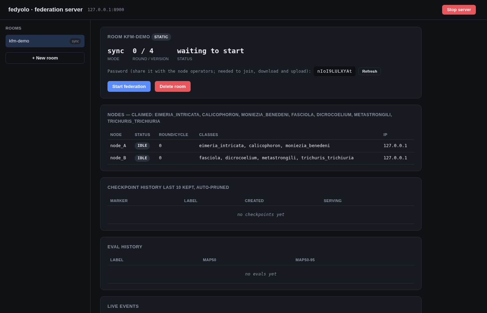
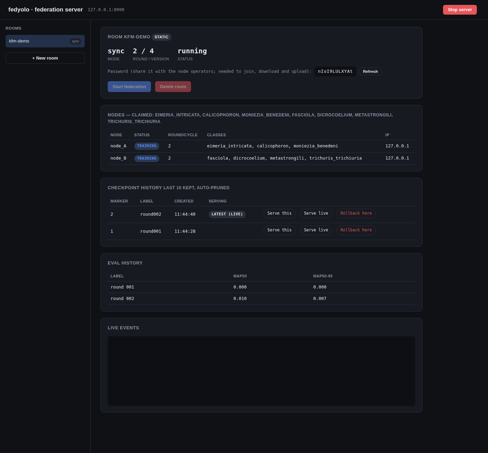
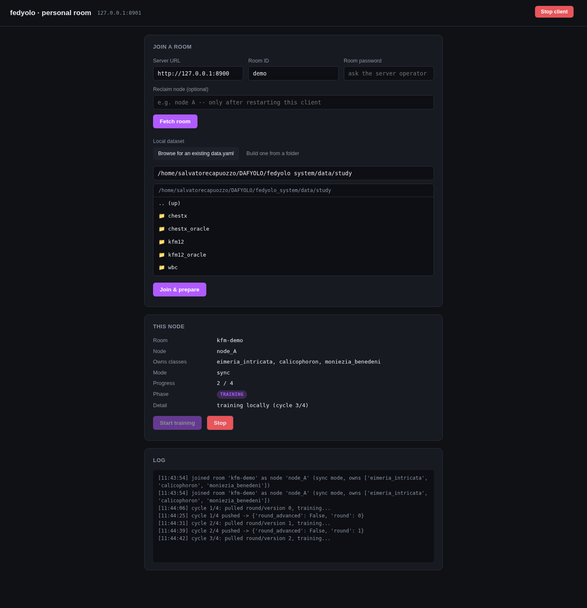
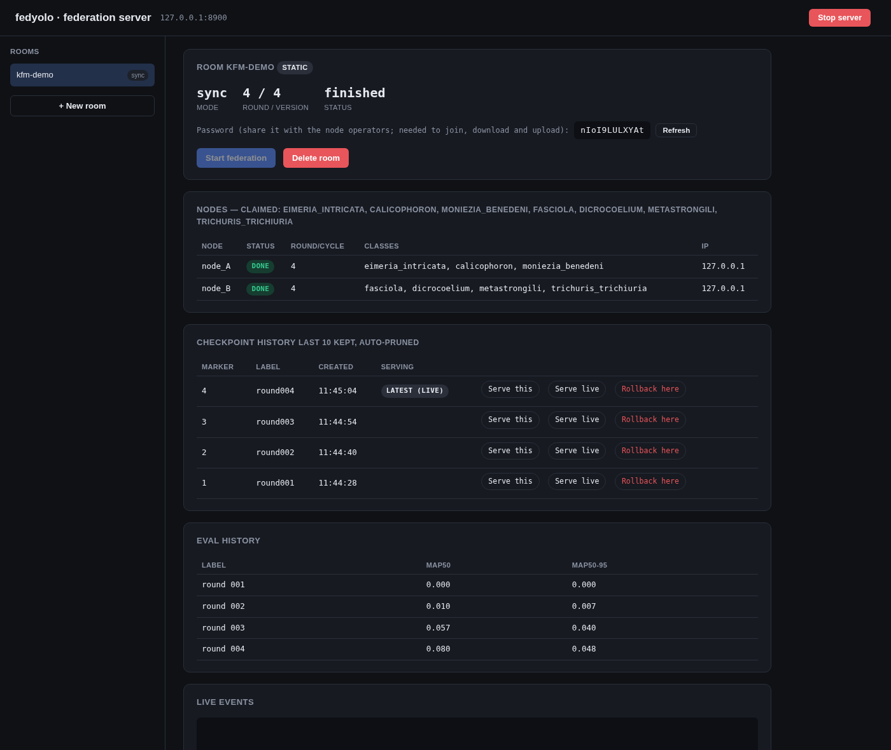
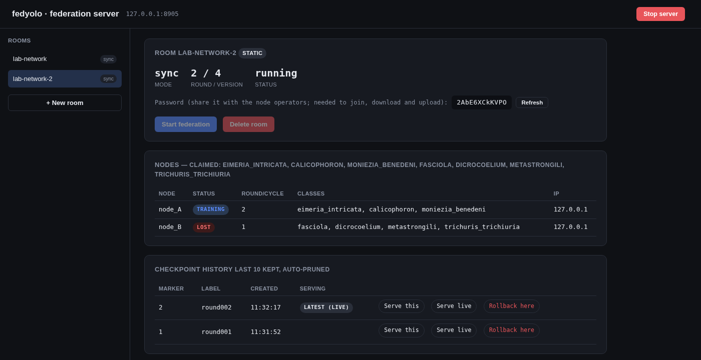

# DAFYOLO over the network — guide for server operators and node operators

This guide covers the networked version of DAFYOLO (`fedyolo/net/`): what it
is, why it is useful, the design choices that make it robust and secure,
and how to start it and join it from other machines on the same network.

- [1. What it is](#1-what-it-is)
- [2. Advantages](#2-advantages)
- [3. Security and robustness by design](#3-security-and-robustness-by-design)
- [4. Requirements](#4-requirements)
- [5. Starting the server](#5-starting-the-server)
- [6. Joining as a node from another machine](#6-joining-as-a-node-from-another-machine)
- [7. The main windows](#7-the-main-windows)
- [8. Day-to-day operations](#8-day-to-day-operations)
- [9. HTTPS](#9-https)
- [10. Developer mode (server-side evaluation)](#10-developer-mode-server-side-evaluation)
- [11. Troubleshooting](#11-troubleshooting)
- [12. Limitations](#12-limitations)
- [13. Command reference](#13-command-reference)

---

## 1. What it is

DAFYOLO trains one YOLO object detector across several **nodes** (sites,
labs, machines) that each hold **their own images** and label **only their
own classes** — e.g. one lab annotates three parasite species, another lab
four different ones. No node ever sends images or labels anywhere: nodes
send only model weights.

The networked version runs this as a real distributed system:

```
                        ┌──────────────────────────────┐
                        │  SERVER  (one machine)       │
                        │  server_app  :8900           │
                        │  - rooms (one per training)  │
                        │  - merges node updates       │
                        │  - dashboard for the operator│
                        └──────▲───────────────▲───────┘
            weights down /     │               │     weights down /
            update up (HTTP/S) │               │     update up (HTTP/S)
                ┌──────────────┴───┐     ┌─────┴──────────────┐
                │ NODE A machine   │     │ NODE B machine     │
                │ client_app :8901 │ ... │ client_app :8901   │
                │ own images+labels│     │ own images+labels  │
                │ trains locally   │     │ trains locally     │
                └──────────────────┘     └────────────────────┘
```

- A **room** is one federated training run, created on the server from a
  config file (fixed nodes and classes) or from scratch (nodes declare their
  classes when they join).
- **Sync** rooms work in rounds: every node trains on the same global model,
  the server waits for all of them, merges, and starts the next round.
- **Async** rooms have no barrier: each node pulls the latest model, trains,
  and pushes whenever it is ready; the server merges each update as it
  arrives, discounting updates computed on an older model.
- Local training and merging use **exactly the same code** as the in-process
  study runs (`fedyolo.simulate`), so results are comparable.

## 2. Advantages

**For the data owners**
- Images and labels never leave the node's machine. The server only ever
  holds model weights; each node's optimizer state (momentum) also stays on
  its own machine.
- Each node trains only on the classes it actually annotated: classes it
  doesn't own are masked out of its loss, so missing labels are never
  learned as "background".
- A node can join with any YOLO-format dataset folder; the page can build
  the `data.yaml` for it.

**For the training itself**
- Disjoint class ownership is handled natively: the class-specific output
  weights for class *c* are merged only from the nodes that own *c*; shared
  layers are merged from everyone.
- Both merge strategies, sync and async, plus the study's merge variants
  (FedNova, Fisher, TIES for sync; CA2FL/FedBuff, FedAsync mixing for async).
- On real separate machines nodes train **at the same time**: no single GPU
  limits how many nodes can train concurrently, and async updates arrive
  genuinely stale, as they would in deployment (the one-GPU simulation
  cannot reproduce this).
- **Dynamic rooms**: nodes can join with classes nobody declared before;
  in async dynamic rooms, new nodes and new classes can be added mid-run.

**For the operator**
- Web dashboards for both roles, no command line needed after start-up.
- Live view of every node (status, round, classes, IP), checkpoint history
  with **serve** (pin the model new nodes receive) and **rollback**.
- Survives failures: lost nodes, network drops, and a server restart
  (see section 3).

## 3. Security and robustness by design

Each measure below answers a specific consideration about running a
federation across several machines. Every measure marked as tested was
exercised against a live server with real client processes.

### Security

| Consideration | Measure | Tested |
|---|---|---|
| Room management and passwords are the operator's business, and the server is reachable from the whole network | Admin actions (creating/deleting rooms, reading passwords, checkpoints, rollback, shutdown) are accepted only from the server machine itself or with the **admin token** printed at start-up; `--require-admin-token` requires the token everywhere | Listing rooms, reading a password or shutting down without the token → **403** |
| A file received from another machine must never be able to run code | Everything exchanged is plain tensors and numbers, loaded with `torch.load(weights_only=True)` on both sides | A crafted pickle is rejected (**400**) and its code does not run |
| A malformed or corrupted update must never reach the global model | Every update is checked against the room's own model: same tensor names and shapes, finite values only, size limit (`--max-upload-mb`) | Wrong tensor shape → **400**; NaN weights → **400** |
| Which classes a node owns is decided by the room, not by the node | The server uses its own registry of each node's classes when merging | — |
| Only a room's nodes may download its model, and each node may act only as itself | Room password **and** a per-node secret token (issued at join, stored hashed) on every node request | No token → **403**; another node's token → **403** |
| Traffic may cross a network that isn't fully trusted | Optional **HTTPS** (`--ssl-certfile`/`--ssl-keyfile`); clients can trust a private certificate (`--ca-cert`) | Untrusted certificate refused; trusted certificate works; plain HTTP to the HTTPS port refused |
| A node may be malicious or faulty (sends boosted, inverted or noisy updates, corrupted BatchNorm statistics, rows for classes it doesn't own) | Optional defence `federation.robust.defense: ora` (`fedyolo/robust.py`): ownership from the registry, every part of an upload (shared weights, BatchNorm statistics, each class row) bounded by κ x the other nodes' median size, trimmed mean in parallel sync; every decision logged in `robust_log.jsonl`. Threat model and study: `analysis/ROBUSTNESS_PLAN.md` | Unit test (CPU): a x10 boosted update is cut to 2x; rows claimed for others' classes are ignored |
| Only what the merge needs should leave a node | The node's optimizer state (momentum) stays on its machine; uploads contain only weights and counts (also half the upload size) | — |

### Robustness

| Consideration | Measure | Tested |
|---|---|---|
| Networks drop briefly and servers get restarted | Every client request is retried with back-off (2 s → 60 s) until it succeeds or the user stops the node | Server killed mid-round: the client retried after 2, 4, 8, 16 s and carried on once the server was back |
| A node machine can crash or go offline mid-round; a sync round shouldn't depend on every node staying alive | Nodes send a heartbeat every 20 s. A node silent past `--heartbeat-timeout` is marked **lost** and the round is merged with the nodes that reported; classes owned only by the lost node keep their previous weights. `--sync-round-timeout` optionally caps any wait | Client killed mid-run: the round was merged without it after the timeout and the room finished |
| An async room's end shouldn't depend on nodes that are gone | An async room finishes when every node is either done or gone | — |
| An upload may be retried after its answer was lost | Each upload carries a `push_id`; a repeated upload gets the recorded answer and is never merged twice | Same upload sent twice: counted once (`duplicate: true`) |
| Trainings can last days; the server must be restartable at any time | Rooms, passwords, node tokens (hashed), counters, checkpoints and unfinished sync rounds are saved under `--state-dir` after every change and restored at start-up | Server killed and restarted mid-round: room restored at the right round, run completed |
| A node's client may be restarted | **Reclaim node** by name once the previous session has gone silent; the previous token stops working | Reclaim refused while the node is alive (409), accepted once silent (200); previous token → 403 |
| Evaluation can take a while; uploads shouldn't wait for it | Evaluation (developer mode only) runs in a background thread | — |
| Dataset issues should surface as early as possible, and datasets copied between machines should keep working | Checked at **join**: a `data.yaml` whose `path:` points to another machine is repaired in a copy (the original is untouched) when its folders sit next to it; class names must match the node's classes exactly | Dataset copied from another computer repaired; mismatched class names rejected |
| A client must never rely on a membership the server no longer recognizes (room recreated, password changed) | Before reusing an existing membership, the client checks it with the server; otherwise it joins again | Room deleted and recreated: both clients joined the new room correctly |
| A room must train with exactly the merge its config specifies | Every merge option is applied (sync: FedNova, Fisher, TIES, weight basis; async: CA2FL/FedBuff, FedAsync mixing) | — |
| Rooms should be shareable as links | `http://<server>:8900/room/<id>` opens that room directly | Used for the screenshots below |

### Training schemes and the end-of-training calibration

The two schemes evaluated in the confirmatory study
(`analysis/CONFIRMATORY_PREREG.md`) run as they were simulated:

| Scheme | Room config | What the server does |
|---|---|---|
| Sequential (synchronous turns) | `mode: async`, `async_order: shuffle`, `max_concurrent_nodes: 1`, `swa_last: 4` | Schedules the turns: a seeded random node order every cycle. Only the node whose turn it is may download and upload. The others are told "not your turn" (409) and ask again every 10 s. The turn of a node that has gone silent is skipped. Final model: the average of the last 4 global versions |
| Concurrent (asynchronous) | `mode: async`, `swa_per_node: true` | Merges every upload on arrival, weighted by its staleness. Final model: the average of the global versions right after each node's last update |

With `final_calibration: true`, training is followed by the **calibration
phase**, done by the nodes themselves:
1. Each node sends the BatchNorm statistics of the final model on its own
   images (`POST .../calib/bn`, 0.25 MB).
2. Each node re-fits only its own class rows on the pooled model and sends
   them (`POST .../calib/rows`, a few KB).

The two schemes run this phase differently:
- **Sequential rooms (and sync rooms):** every node's statistics are pooled first (a barrier), and the calibrated model is released once complete.
- **Concurrent rooms:** nobody waits. The server releases a better model after every contribution. Nodes not heard from yet are represented by the final model's own statistics, weighted by their batch count from their training uploads.
- **`progressive_refresh: true`:** once everyone has contributed, every node re-fits its rows once more on the complete pool.

Nodes keep downloading the latest released model throughout. The client
runs the phase on its own after its last training cycle. The room's
snapshot (`GET /api/rooms/{id}`) shows `turn` and `calibration`.

Tested on 2026-10-28 with a live server and two client processes (CPU,
two WBC nodes, two cycles each):
- **Sequential room:**
  - turns B, A, A, B (a new order each cycle); the waiting node was refused and retried;
  - the calibration waited for both nodes' statistics, then both nodes' rows;
  - the room saved `final` and `calibrated` models.
- **Concurrent room:**
  - both nodes trained at the same time;
  - the first node to finish waited only for the end of training;
  - the calibration released a model after each of the 6 contributions (2 statistics, 2 rows, 2 refreshes) without a barrier;
  - the room saved `final` and `calibrated` models.

## 4. Requirements

**Every machine (server and nodes)**
- This repository (`fedyolo_system/`) and the `dafyolo` Python environment
  (see the study handoff: Python 3.10, PyTorch, `ultralytics==8.4.84`, and
  `requirements.txt`, which includes `fastapi`, `uvicorn`,
  `python-multipart`, `requests`).
- Commands are run from inside `fedyolo_system/`:
  ```bash
  cd ~/DAFYOLO/fedyolo_system
  conda activate dafyolo
  ```

**Server machine**
- The room config files (in `configs/`, or another folder given with
  `--config-dir`).
- Incoming TCP port **8900** open to the local network (see 5.3).
- No GPU needed and no training data: it only merges weights.

**Each node machine**
- Its own dataset in YOLO layout (`images/train`, `images/val`,
  `labels/train`, `labels/val`) and a `data.yaml` whose `names` list is
  **exactly the node's classes, in the same order** as the room assigns them.
- A GPU is strongly recommended: the study model (YOLO26-classic l, 640 px,
  batch 4) peaks at about **6.6 GB** of VRAM. Smaller models (e.g. `yolov8n`)
  fit much smaller GPUs; CPU works but is slow.
- Network traffic per round: one model download and one upload — about
  **100 MB each** for the study model, about 12 MB for `yolov8n`.

## 5. Starting the server

### 5.1 Start it

```bash
cd ~/DAFYOLO/fedyolo_system && conda activate dafyolo
python -m fedyolo.net.server_app --port 8900
```

At start-up the server prints:
- the address it listens on (all network interfaces by default);
- how many rooms it **restored** from `runs/net_server_state/`;
- the **admin token** (also saved in `runs/net_server_state/admin_token`,
  readable only by you). Keep it private.

Leave this terminal open, or start it detached so it keeps running after
the terminal (or VS Code) is closed:

```bash
python tools/launch_detached.py runs/net_server.log -- python -m fedyolo.net.server_app --port 8900
tail -f runs/net_server.log          # the admin token is printed near the top
```

### 5.2 Find the address to give to the node operators

```bash
hostname -I            # Linux: first address, e.g. 192.168.1.23
ipconfig getifaddr en0 # macOS
```

The server URL for everyone else is then `http://192.168.1.23:8900`
(or `https://...` with HTTPS, section 9).

### 5.3 Open the port

- **Ubuntu with ufw enabled**: `sudo ufw allow 8900/tcp`
  (check with `sudo ufw status`; nothing to do if ufw is inactive).
- **macOS**: accept the "allow incoming connections" prompt for Python.
- Test from another machine: open `http://<server-ip>:8900/api/info` in a
  browser; it should show `{"developer_mode":false,"protocol":2}`.

### 5.4 Create a room and share its details

1. On the server machine open **http://127.0.0.1:8900** (see
   [7.1](#71-server--create-a-room)).
2. Pick a config, give the room an ID (e.g. `kfm-demo`), **Create room**.
3. Send each node operator three things: the **server URL**, the **room
   ID**, and the **room password** shown on the room card.
4. When the nodes you want have joined, press **Start federation**.

The dashboard can also be opened from another machine
(`http://<server-ip>:8900`): it asks once for the admin token.

## 6. Joining as a node from another machine

Each node operator, on **their own** machine:

1. Start the personal client (it listens only on that machine):
   ```bash
   cd ~/DAFYOLO/fedyolo_system && conda activate dafyolo
   python -m fedyolo.net.client_app --port 8901
   ```
2. Open **http://127.0.0.1:8901** in a browser **on that same machine**
   (see [7.2](#72-node--join-a-room)).
   - Machine without a screen? From your laptop:
     `ssh -L 8901:127.0.0.1:8901 user@node-machine`, then open
     `http://127.0.0.1:8901` on the laptop.
3. Fill in **Server URL** (`http://<server-ip>:8900`), **Room ID** and
   **Room password**; press **Fetch room** to check the connection.
4. Choose the local `data.yaml` (browse to it, or build one from a folder).
   Dynamic rooms also ask for your class names.
5. **Join & prepare**. The server assigns the next free node and tells you
   which classes it owns; the client checks your dataset against them.
6. Once the server operator has started the federation, press
   **Start training**. Leave the client running; it trains, uploads, and
   waits for the other nodes automatically.

If you restart the client later, fill in **Reclaim node** with your node
name (e.g. `node_A`) and join again, after about 3 minutes of silence (the
server's heartbeat timeout).

## 7. The main windows

Screenshots from a two-node sync room (`kfm-demo`, parasite-egg dataset),
server and both clients on one machine (addresses show `127.0.0.1`; on a
real network they show each machine's LAN address).

### 7.1 Server — create a room



Pick a config file (preview on the right) or switch to **Build from
scratch** for a dynamic room. The evaluation-dataset field appears **only in
developer mode** (section 10); it is hidden in normal use.

### 7.2 Node — join a room



Top: server URL, room ID, password, optional **Reclaim node**, and the
dataset browser (it only shows this machine's files). Bottom, after
joining: the node assigned by the server (`node_B`), the classes it owns,
and the log.

### 7.3 Server — room waiting to start



Both nodes have joined (`IDLE`), each with its classes and IP address.
The room password to share is on the card. **Start federation** begins
round 1.

### 7.4 Server — training in progress



Round 2 of 4. Each round creates a checkpoint (last 10 kept): **Serve
this** pins which model new downloads receive, **Rollback here** resets the
room to that point. The evaluation history is shown here in developer mode.

### 7.5 Node — training in progress



The node's phase (`TRAINING`), its progress, and a log of each cycle:
model downloaded, trained, uploaded, and the server's answer. Network
problems appear here as `RECONNECTING` with the next retry time.

### 7.6 Server — finished



All 4 rounds done, both nodes `DONE`, all checkpoints available.

### 7.7 Server — a node drops out



Node B's machine stopped responding after round 1. After the heartbeat
timeout it is marked `LOST` and the room continues with node A (round 2
running). Node B's classes keep their last merged weights until it comes
back or reclaims its slot. The sidebar also lists `lab-network`, a room
this server **restored from disk** after being restarted.

## 8. Day-to-day operations

| Task | How |
|---|---|
| Stop a node temporarily | **Stop** on its page (halts once its current local training round is done); **Start training** resumes |
| A node machine crashed / was rebooted | Restart its client, join with **Reclaim node** = its node name (after ~3 min of silence) |
| Restart the server | Stop it (dashboard **Stop server**, Ctrl+C, or `kill`) and start it again with the same `--state-dir`: rooms resume, clients reconnect by themselves |
| Change the room password | **Refresh** on the room card. Nodes already in the room are refused from their next request; they rejoin with the new password using **Reclaim node** (after ~3 min of silence) |
| Undo a bad stretch of training | **Rollback here** on an earlier checkpoint |
| Give late joiners an older model | **Serve this** on that checkpoint (**Serve live** to undo) |
| End a dynamic async room | **Finish room** (these never end by themselves) |
| Delete a room | **Delete room** (only when not running); checkpoints stay on disk |
| Where things are on the server | Room state: `runs/net_server_state/rooms/<room>/`; checkpoints: `<output_dir>/net_room_<room>/` |

## 9. HTTPS

On the server machine, create a certificate once (replace `<server-ip>`):

```bash
openssl req -x509 -newkey rsa:2048 -nodes -days 365 -subj "/CN=<server-ip>" \
    -addext "subjectAltName=IP:<server-ip>" -keyout key.pem -out cert.pem
python -m fedyolo.net.server_app --port 8900 --ssl-certfile cert.pem --ssl-keyfile key.pem
```

Give `cert.pem` (never `key.pem`) to each node operator. They start their
client with:

```bash
python -m fedyolo.net.client_app --port 8901 --ca-cert /path/to/cert.pem
```

and use `https://<server-ip>:8900` as server URL. Browsers opening the
dashboard will warn about the self-signed certificate; that is expected.

## 10. Developer mode (server-side evaluation)

In real use the server never holds labeled data, so it **does not
evaluate** the model. For testing only, start it with:

```bash
python -m fedyolo.net.server_app --port 8900 --developer-mode
```

It prints a warning, and the room-creation form shows an extra field for an
**evaluation dataset** (a `data.yaml` on the server machine whose class
names match the room's classes). If left blank, the server uses the
config's own `eval_data_yaml`, else the nodes' validation data when it can
reach them (everything on one machine). Evaluation then runs in the
background every `eval_interval` rounds/submissions and at the end, and
appears in the room's **Eval history**.

## 11. Troubleshooting

| Symptom | Cause / fix |
|---|---|
| Client: "could not reach server" | Wrong URL, server not running, or port 8900 blocked (5.3). Test `http://<server-ip>:8900/api/info` from the node's browser |
| Client: "wrong or missing room password" | Password mistyped, or refreshed by the operator |
| Client: "every node in this room is already claimed" | All slots taken. A restarted client must use **Reclaim node** |
| Client: "node … is still active … can be reclaimed after 180 s" | The old session is still sending heartbeats (or stopped less than 3 min ago); wait and retry |
| Client: "dataset's class names … must exactly match" | Fix `names:` in the `data.yaml` (same classes, same order), press **Join & prepare** again — you keep your node |
| Client: "training/validation images not found" | The `train:`/`val:` folders in `data.yaml` don't exist relative to its `path:` or its own folder |
| Client shows `RECONNECTING` | Server unreachable; the client keeps retrying on its own |
| Dashboard from another machine: "admin access required" | Enter the admin token (`runs/net_server_state/admin_token` on the server) |
| Node marked `LOST` although it is training | Its heartbeats aren't arriving (network) — or `--heartbeat-timeout` is too short for your network |
| Room "not started yet" when a node starts training | The operator hasn't pressed **Start federation**; the node waits by itself |

## 12. Limitations

- Meant for a trusted local network or a VPN, not for exposure on the
  internet. The room password is a shared secret; use HTTPS when the
  network is not fully trusted.
- If a **client** restarts, its momentum buffers restart from zero (they
  never leave the node's machine); training continues normally.
- After a **server** restart, async rooms rebuild their internal caches
  (the CA2FL cache and the recent-model cache) as nodes submit; sync rooms
  resume exactly.
- A sync round merged without a lost node leaves that node's classes at
  their last merged weights for that round.
- In async dynamic rooms, a class declared late starts from its initial
  weights and needs its own rounds to catch up.
- A server restart during the calibration phase restarts that phase from
  the final model: contributions already received are not persisted. A
  completed calibration is kept.
- A sequential room should be started once every node has joined. Turns
  of nodes that are not connected are skipped.

## 13. Command reference

**Server** — `python -m fedyolo.net.server_app [options]`

| Option | Default | Meaning |
|---|---|---|
| `--port` | 8900 | TCP port |
| `--host` | 0.0.0.0 | interface to listen on (all) |
| `--config-dir` | `configs` | folder listed in the "create room" dropdown |
| `--config`, `--room` | — | create a room at start-up from this config, with this ID |
| `--state-dir` | `runs/net_server_state` | where rooms are saved and restored from |
| `--admin-token` | generated (env `FEDYOLO_ADMIN_TOKEN`) | admin token for remote dashboard / API |
| `--require-admin-token` | off | require the token even from the server machine (use behind a local reverse proxy) |
| `--heartbeat-timeout` | 180 s | silence after which a node is `lost` |
| `--sync-round-timeout` | 0 (off) | > 0: merge a sync round after this many seconds even if a node is alive |
| `--max-upload-mb` | 2048 | largest accepted update |
| `--ssl-certfile`, `--ssl-keyfile` | — | enable HTTPS |
| `--developer-mode` | off | allow server-side evaluation |

**Client** — `python -m fedyolo.net.client_app [options]`

| Option | Default | Meaning |
|---|---|---|
| `--port` | 8901 | port of this node's page (one client per node; use a different port per node on the same machine) |
| `--host` | 127.0.0.1 | the page is reachable only from this machine |
| `--ca-cert` | — | trust this certificate for an HTTPS server |

Further technical details: `fedyolo/net/README.md`.
